# ずんだもんのこいこい

[](https://unity.com/)
[](https://learn.microsoft.com/dotnet/csharp/)
[](https://github.com/Cysharp/UniTask)


Unity で制作した、花札「こいこい」の CPU 対戦ゲームです。ずんだもん(プレイヤー)と春日部つむぎ(CPU)が、1〜12 月戦で文数を競います。

| タイトル | 対局 |
|:---:|:---:|
| 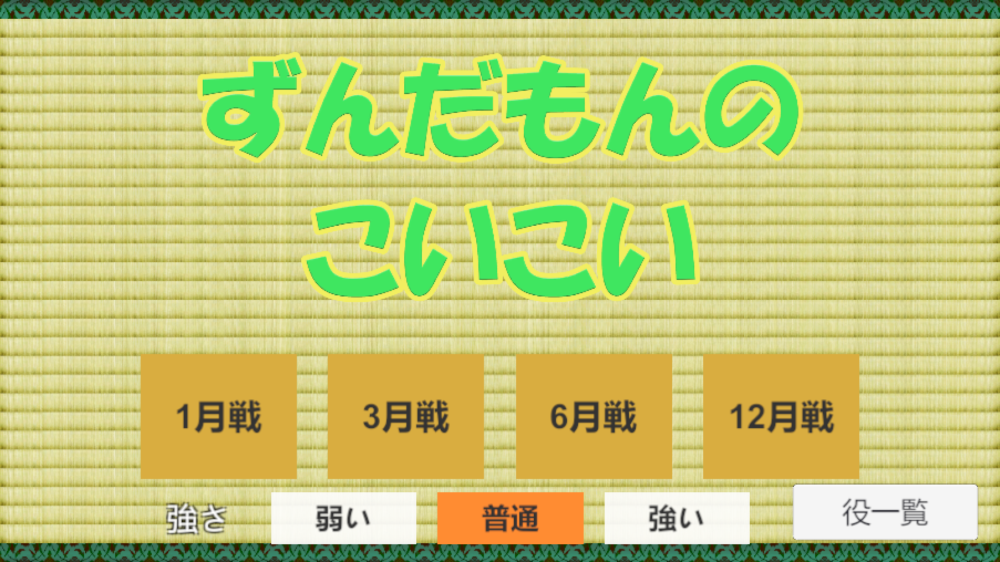 | 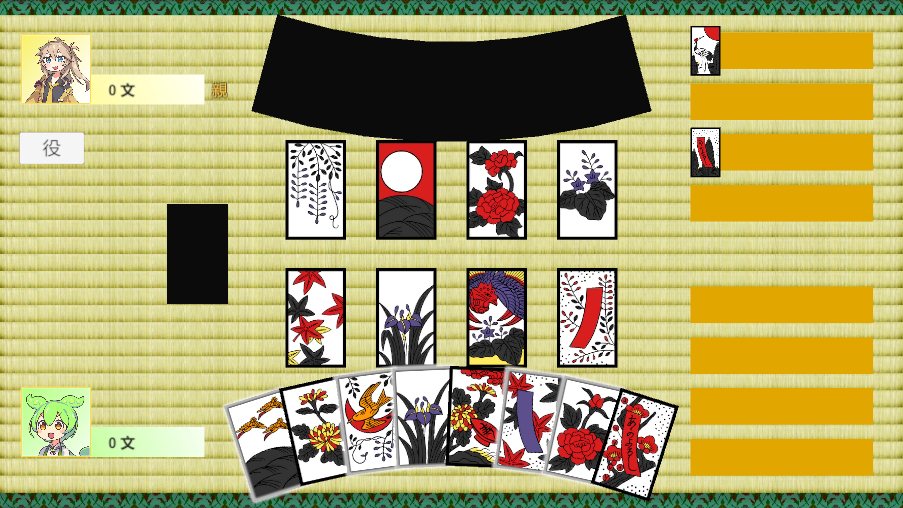 |

## このプロジェクトの見どころ

- **手札を覗かない CPU 思考**: CPU に渡す盤面情報から相手の手札を除外し、見えている札だけで役の進み具合と相手のリスクを評価します。
- **演出とゲーム進行の非同期制御**: 札の移動やカットインを UniTask で直列につなぎ、局が変わると前の局の待機処理をまとめてキャンセルします。
- **Unity に依存しないルール層**: 役判定・精算・CPU 思考を `MonoBehaviour` から切り離し、表示側と責務を分けています。

## ゲームの流れ

| 1. 親決め | 2. 札を選ぶ |
|:---:|:---:|
| 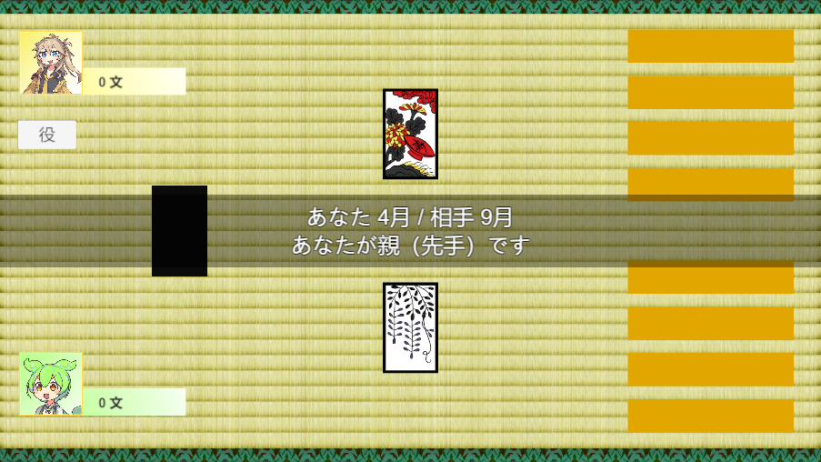 | 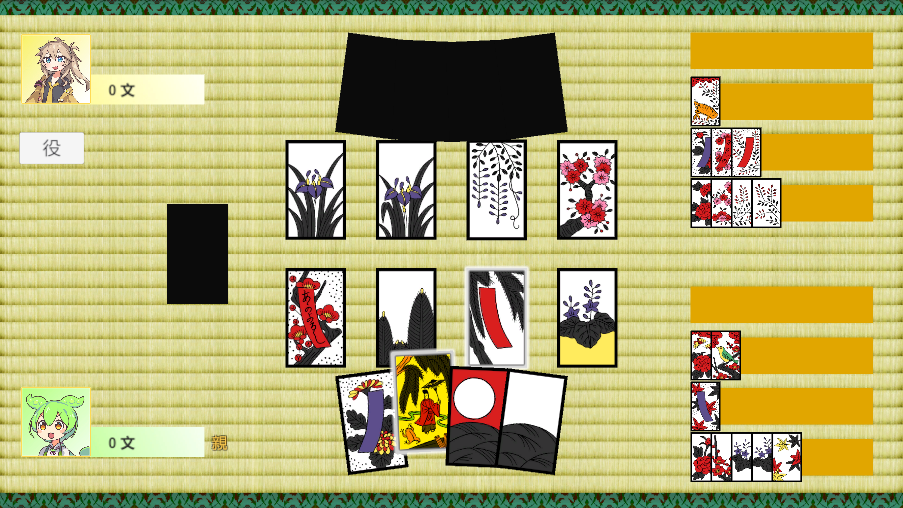 |
| 札を引いて、月が早い方が親になります。 | 手札を選ぶと、取れる場札が光ります。 |

| 3. 役の成立 | 4. 成立した役の表示 |
|:---:|:---:|
| 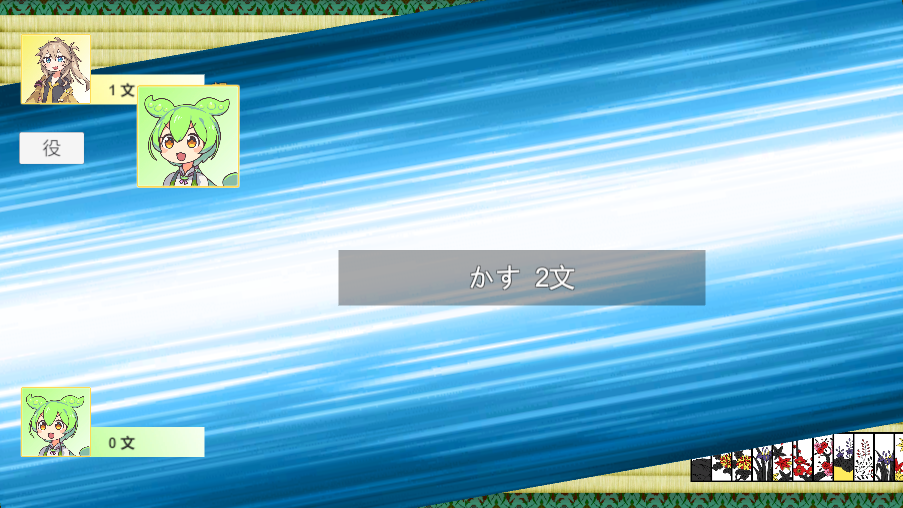 | 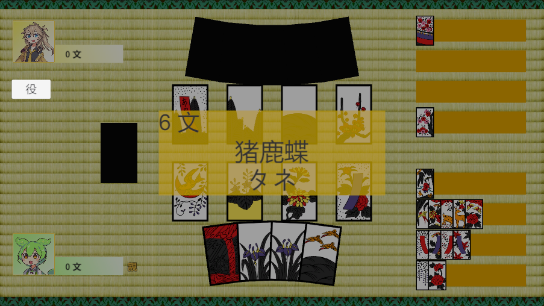 |
| 役を作った側のキャラクターと役をカットインで見せます。 | 成立した役と合計の文数を確認します。 |

| 5. こいこいか勝負か | 6. こいこい中 |
|:---:|:---:|
| 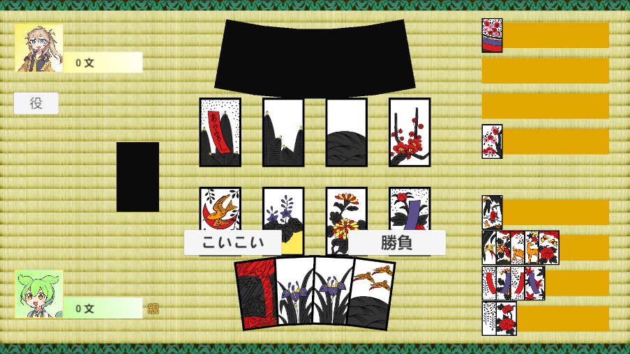 | 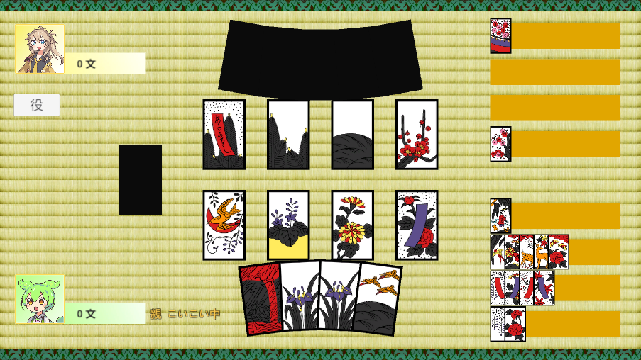 |
| 続けるか、ここで上がるかを選びます。 | 親とこいこいの状態はスコアの横に表示します。 |

| 7. 精算 | 8. 結果 |
|:---:|:---:|
| 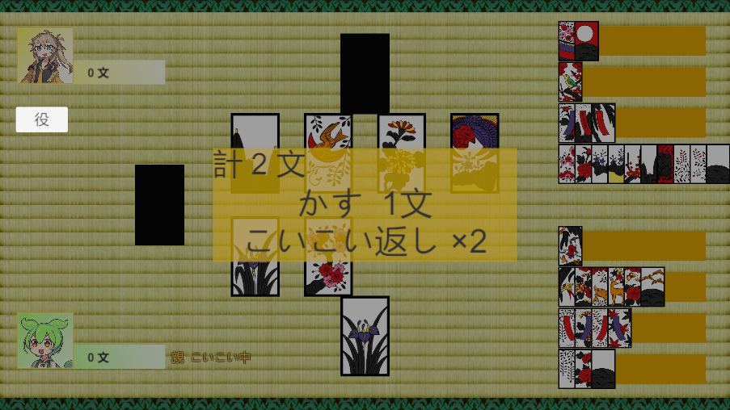 | 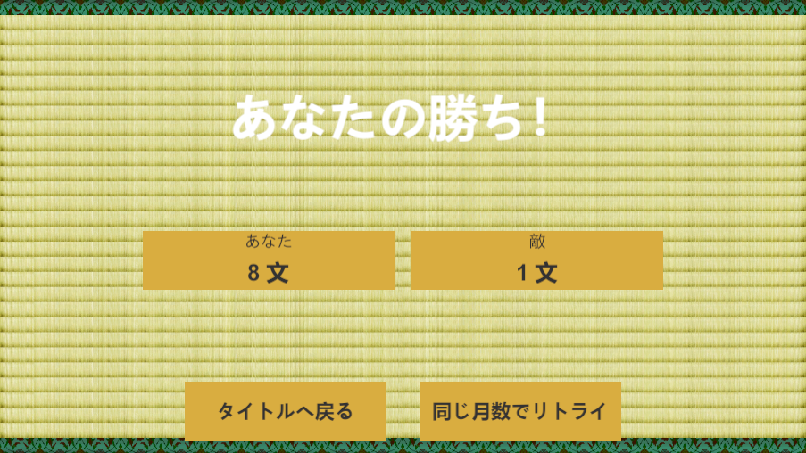 |
| 倍付けがあるときは内訳を表示します。 | 全局の合計文数で勝敗を決めます。 |

## 開発概要

| 項目 | 内容 |
|---|---|
| エンジン | Unity 6000.3.10f1 (2D) |
| 言語 | C# |
| 主なライブラリ・機能 | UniTask / uGUI / Animator / Sprite Atlas |
| 規模 | C# スクリプト 24 ファイル、約 3,300 行 |
| 開発期間 | 2026-04-30 〜 2026-10-02(65 コミット) |

## ゲーム仕様

- 対局数は 1・3・6・12 月戦から選択します。
- CPU の強さは「弱い」「普通」「強い」の 3 段階です。
- 最初の局は札を引いて親を決め、以降は上がった側が親になります(流局なら親は据え置き)。
- 場札に同じ月が 4 枚そろった場合は配り直します。
- 手札だけで成立する手四・くっつきは、配られた時点で 6 文の上がりになります(双方にあれば親を優先)。
- 最終手番で役ができた場合は次の手番がないため、こいこいを選べず上がりになります。

### 役と点数

| 役 | 文 | 条件 |
|---|---:|---|
| 五光 | 15 | 光札 5 枚すべて |
| 四光 | 8 | 雨(柳に小野道風)以外の光札 4 枚 |
| 雨四光 | 7 | 雨を含む光札 4 枚 |
| 三光 | 5 | 雨以外の光札 3 枚 |
| 猪鹿蝶 | 5 | 萩に猪・紅葉に鹿・牡丹に蝶 |
| 赤短 / 青短 | 5 | 対応する短冊 3 枚 |
| 花見で一杯 / 月見で一杯 | 5 | 桜に幕または芒に月 + 菊に盃 |
| タネ / タン | 1〜 | 5 枚で成立、1 枚増えるごとに +1 文 |
| かす | 1〜 | 10 枚で成立、1 枚増えるごとに +1 文 |

上がったときの倍率は、役の合計が 7 文以上で ×2、相手がこいこい中(こいこい返し)で ×2 です。両方を満たすと ×4 になります。

ゲーム内でも、役の条件と成立例の札をいつでも確認できます。

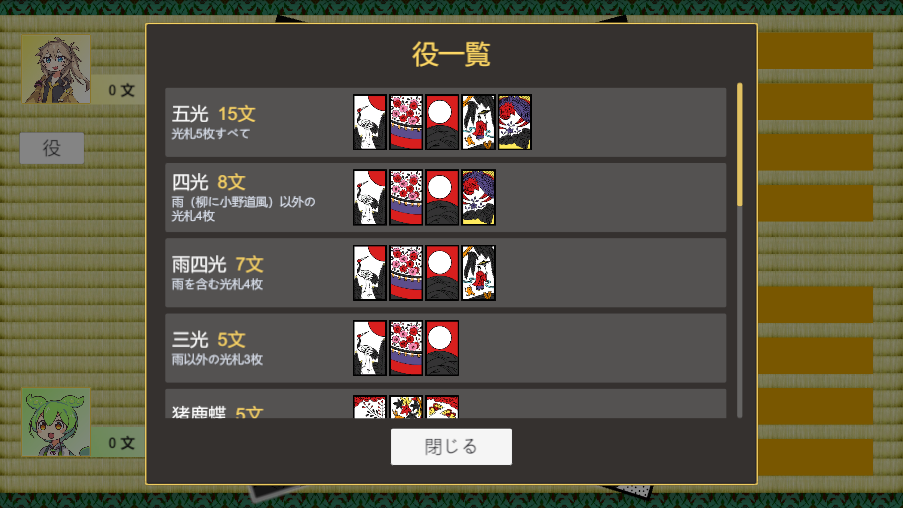

## 設計

`GameManager` が局の進行を担当し、ルールの判断は Unity に依存しないクラスへ、画面の更新は View 系のコンポーネントへ委譲しています。

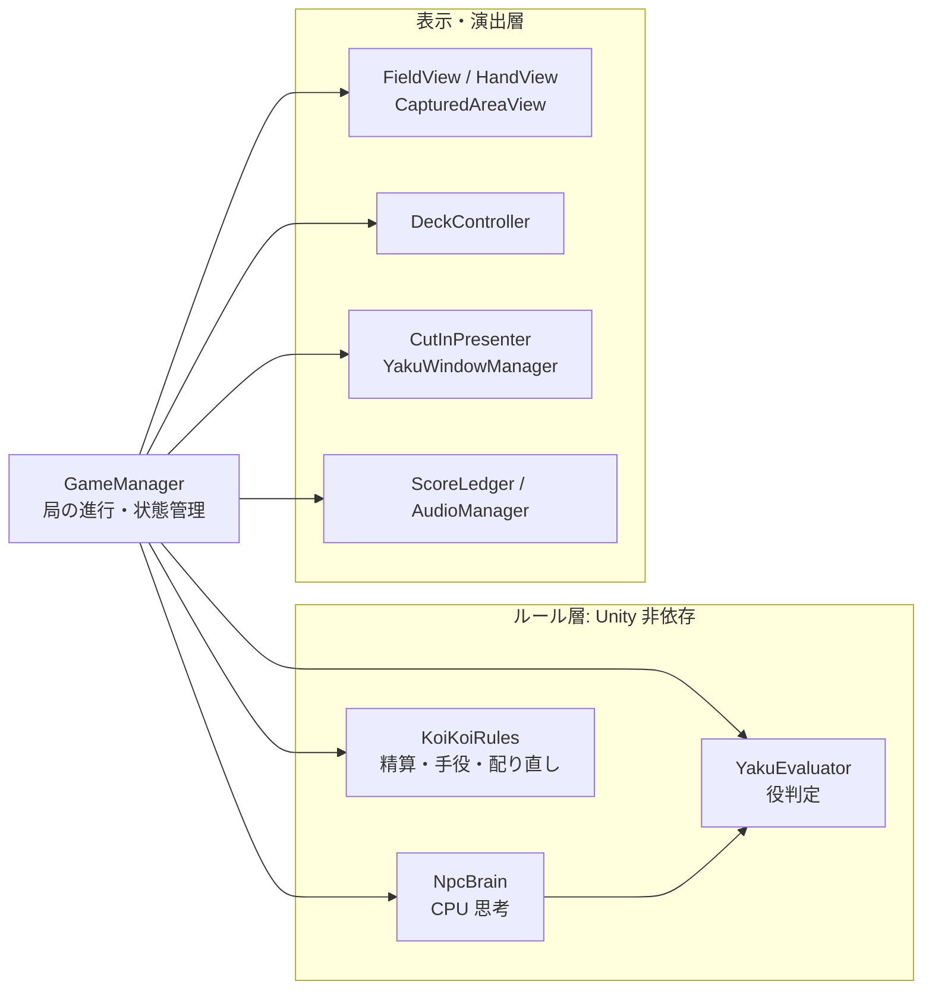

開発の途中で、`GameManager` に集まっていた役判定・場札・手札・取り札・山札の処理を順にクラスへ切り出しました。

## CPU 思考(`NpcBrain`)

`GameManager.BuildEnemySnapshot` が作る `BoardSnapshot` には、CPU 自身の手札、場札、双方の取り札だけを入れます。プレイヤーの手札と山札は「見えていない札」として 1 つのリストにまとめるため、CPU はどの札がプレイヤーの手札かを区別できません。

| 強さ | 打ち手の評価 | こいこい |
|---|---|---|
| 弱い | ランダム(取れる札があれば 60% の確率で取る) | しない |
| 普通 | 札そのものの価値 | しない |
| 強い | 役の進み具合 + 相手が欲しい札の妨害 + 捨て札を取られるリスク | 状況で判断する |

「強い」の評価には、次の考え方を使っています。

- **役への近さ**: 成立済みの点数に、未成立の役の `点数 × 進捗²` を加えます。相手に札を取られて成立しなくなった役は除外し、排他的な光札系の役は最も見込みの高いものだけを数えます。
- **捨て札のリスク**: 見えていない札の中の同じ月の枚数と相手の手札枚数から、相手に取られる確率を見積もって減点します。
- **こいこいの判断**: 次のいずれかに当てはまる場合は上がり、それ以外で役が伸びそうなときだけ続行します。
  - 相手がこいこい中(今上がれば 2 倍になる)
  - 残り手札が 3 枚未満
  - 現在の点数が 6 文を超えている
  - 相手があと 1 枚で役になる、またはすでに役を持っている

## 非同期処理とキャンセル

局の開始時に、オブジェクト破棄用のトークンとリンクした `CancellationTokenSource` を作り直します。上がった後に残っている待機処理が次の局に干渉せず、シーン遷移時にも安全に止まります。

```csharp
_roundCts?.Cancel();
_roundCts?.Dispose();
_roundCts = CancellationTokenSource.CreateLinkedTokenSource(_destroyToken);
_roundToken = _roundCts.Token;
```

## デバッグ支援

手四や場札 4 枚のように、自然には発生しにくい局面を確認するために `DebugDealPreset` を用意しました。プリセットを指定すると `KoiKoiRules.BuildDebugDrawOrder` が配り順を組み立て、対象の局面を再現します。

## 今後の課題

- `GameManager` が約 1,000 行あるため、ターン進行と入力処理をさらに分割する
- Unity に依存しないルール層(役判定・精算)に自動テストを追加する

## 実行方法

1. Unity 6000.3.10f1 でプロジェクトを開きます。
2. `Assets/Scenes/Title.unity` を開いて再生します。

UniTask は Package Manager(Git URL)で取得するため、初回に自動で読み込まれます。

## クレジット

- BGM: [料亭で流れてそうな曲14](https://music.storyinvention.com/ryoutei-14/) (Story Invention)
- 音声: VOICEVOX:ずんだもん / VOICEVOX:春日部つむぎ

詳細は [CREDITS.md](CREDITS.md) を参照してください。

> **TODO(公開前に記入)**: 札絵、キャラクターアイコン、カットインエフェクト(`pipo-btleffect*`)、畳などの背景画像の出典と利用規約
